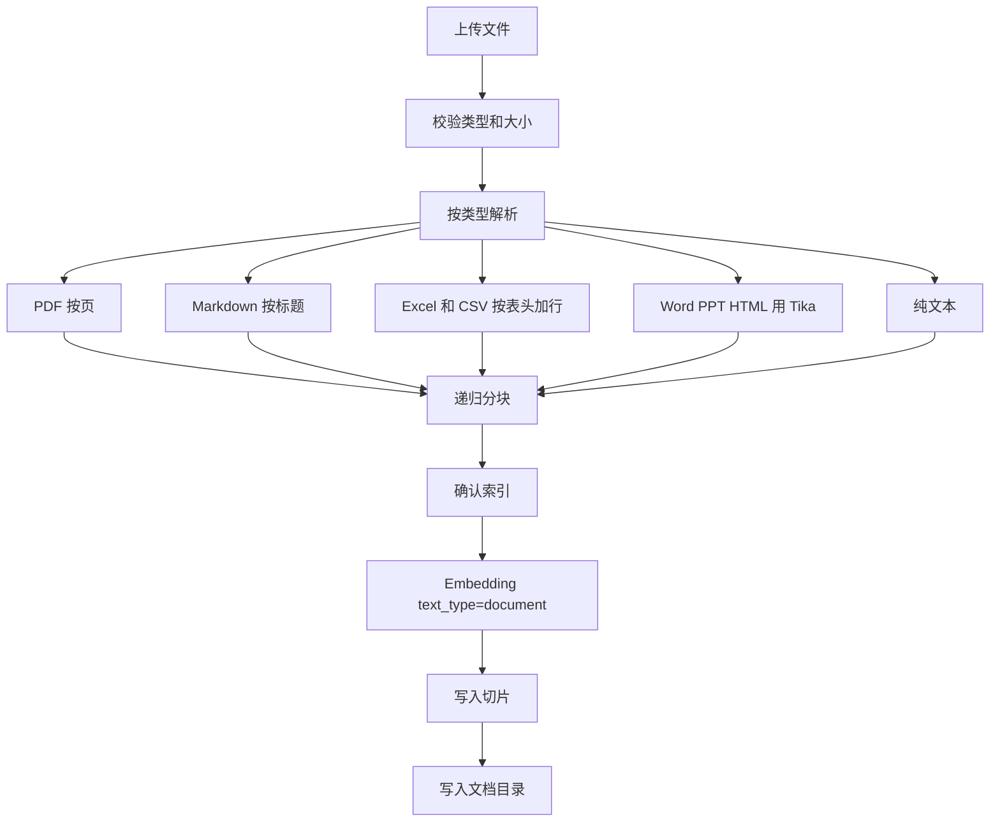
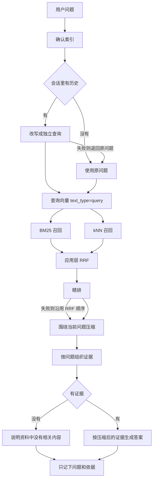

# RagAgent

本机可调试的检索增强问答。倒排索引可以选进程内 BM25，也可以选 Elasticsearch 的 IK。向量、精排和回答走阿里云百炼 DashScope。调试台可以查看切片，以及 BM25、kNN、RRF、精排每一段的分数。

## 架构

```text
浏览器调试台 (Vue, :5173)
        |
        |  /api
        v
Spring Boot (:8080)
  解析 / 分块 / 混合检索 / 生成
        |                         \
        |                          \
        v                           v
倒排索引                        百炼 DashScope
local 或 Elasticsearch          Embedding / Rerank / Chat
```

两条业务路径：

- **入库**：上传文件，按类型解析并分块，批量生成文档向量，写入 Elasticsearch。
- **问答**：按会话改写问题，混合召回后再精排，把引用交给对话模型生成答案。`/api/retrieve` 只做到精排，不生成答案。





倒排索引由 `rag.index.inverted-index` 选择，默认 `local`：

| 取值 | 倒排 | 向量 | 何时用 |
|---|---|---|---|
| `local` | 进程内中文二元组加英文数字词的 BM25 | 内存余弦 | 本机调试，不用启动 Elasticsearch。数据在进程内，重启后清空 |
| `elasticsearch` | 集群上的 IK 倒排 | HNSW kNN | 要保留索引、用 IK 分词时 |

选 `elasticsearch` 时索引有两个：

| 索引 | 内容 |
|---|---|
| `rag-chunks` | 切片正文、1024 维向量，以及文件名、页码、表格、标题、序号 |
| `rag-documents` | 文档目录：文件名、类型、切片数、入库时间 |

`content` 使用 IK：索引 `ik_max_word`，搜索 `ik_smart`。向量字段为 `dense_vector`，余弦相似度，HNSW。

混合检索先各取 BM25 和 kNN 的前 20 条，再在应用里做 RRF，分数是 `1 / (60 + rank)`。同一条切片在一路结果里只计一次。Basic 许可的 Elasticsearch 提供 kNN 和 BM25，原生 `rrf` retriever 属于 Enterprise，所以融合放在应用层。

精排默认把 RRF 前 20 条交给 `qwen3.7-text-rerank`，最终取 Top 5。精排失败时沿用 RRF 顺序，并在响应的 `warning` 里说明。

精排结果不会原样塞进提示词。压缩器先做规则处理，再决定要不要调用模型：

1. 去掉被包含或高度重复的切片。
2. 只保留和当前问题字面相关的原句，并带上它前面的一句，避免把隐含条件一起丢掉。和问题无关的句子不进入上下文。
3. 抽出的证据仍长于 480 字时，才对这一条调用模型，按「条件、结论、例外、原句」抽取。短证据保持原句，不为每个切片都付一次模型调用。
4. 规则过滤后如果一条都不剩，保留精排得分最高的整段，并在 `warning` 里说明。

上下文顺序会影响答案。召回结果混合了通道、来源和版本，不能直接当作提示词顺序。送入模型前按下面的规则重排：

1. 最相关的文档放前面。同一文档里的相邻片段保持原始顺序。
2. 得分达到最高分 72% 的片段算高置信度，其余整段放在后面，不和高置信度交错。
3. 同一标题下数字完全不同，或一边允许一边禁止，会标出两边的版本和入库时间。
4. 每条引用保留文件名、页码、表格、标题、版本和入库时间。
5. 问题里有对比、时间演变或故障排查时，分别按主题、时间线，或「现象、原因、处理步骤、注意事项」组织。

调试台里「送入模型的上下文」就是这个结构。上下文工程处理的是证据在模型输入中的结构，而不仅是召回数量。

## 评估

最终答案只有一个分数时，看不出是检索没找到，还是生成写偏了。评估把两段拆开。

最小评估集在 `backend/src/main/resources/eval/dataset.json`，共 60 条，依据 `samples/eval-corpus.md`。类型覆盖高频问题、容易失败的问题、业务关键问题、多跳、错误码 / 版本 / SKU 精确匹配、过期或越权、以及应该拒答的问题。每条有原始问题、理想答案、应命中的证据、过滤条件和答案类型。

| 指标 | 看的是 | 怎么算 |
|---|---|---|
| Hit Rate@K | 召回 | 前 K 条里有没有应命中的证据 |
| MRR | 排序 | 第一条命中证据有多靠前 |
| Context Recall | 召回完整性 | 送进模型的上下文是否覆盖全部标准证据 |
| Context Precision | 上下文纯度 | 送进模型的片段里，有多少真能对上标准证据 |
| Faithfulness | 生成忠实度 | 答案里的数字、错误码、SKU、日期能否在上下文里找到 |
| Answer Relevancy | 回答相关性 | 标准答案里的这些要点是否出现在回答中；拒答题要明确说资料里没有 |
| Citation Accuracy | 引用准确性 | `[编号]` 指向的片段是否支撑这句话 |
| Latency / Cost | 工程 | 检索和精排的 P95、生成耗时、上下文字符估算的 Token。当前没有检索缓存，缓存命中率留空 |

拒答题不计算命中率。上下文里如果塞进了材料，上下文纯度记为 0，用来发现不该回答的问题被带进了证据。

这些分数是规则对照，不是模型裁判，也不能代替人工。报告里的人工复核队列包含每类第一条，以及检索或生成没通过的样本。抽查时要看自动分是否偏向写得长的答案、是否漏掉引错的句子、是否对中文术语不敏感。失败样本会记在 `/api/eval/failures`，并带上当时的解析、切分、向量、索引、改写、精排和提示词版本。

## 上线顺序

先把文档解析用稳，再谈召回和生成。

1. 入库前去掉页码噪声，保留标题层级、页码、表格和 Metadata。用现有 60 条评估集做回放，覆盖高频、失败、精确匹配、权限和拒答。这一步是基线，切分策略默认 `structured`，查询改写默认只处理多轮指代。
2. 基线稳定后，用 `POST /api/chunks/compare` 比较固定长度、结构化、Parent-Child 和语义切分。向量召回负责语义相近的内容，BM25 保留错误码、版本和 SKU 这类精确词。确认收益后，再把 `rag.rewrite.mode` 改成 `expanded`，处理口语、缩写、多意图和多跳。多意图会拆开分别检索。
3. 候选变多之后，仍然先重排，再去重、裁剪，长片段才做结构化抽取。证据不够时拒答，关键结论带引用。
4. 每次实验最多改解析器、Chunk、Embedding、索引、Query Rewrite、Rerank、Prompt 中的两项。`POST /api/experiments/check` 看改了哪些，`POST /api/experiments/accept` 在超过两项时会拒绝。
5. 问答和检索请求记在 `/api/gray`。离线评估变好之后，还要看同一版本在这些请求里的拒答和延迟。

先上传 `samples/eval-corpus.md`，再在调试台跑检索评估。`POST /api/eval/run` 默认只评检索；请求体里 `"generate": true` 才会逐条调用对话模型。`POST /api/eval/score` 用当前召回和答案对某一条样本打分，不重新请求模型。

多轮对话保存在进程内存里，默认最近 6 轮。记入下一轮的只有当时的问题和依据来源，不保存完整回答。有历史时，才把新问题改写成一句独立检索查询。

## 技术栈

| 组件 | 版本 | 作用 |
|---|---|---|
| JDK | 21 | 运行后端 |
| Spring Boot | 3.5.16 | Web、配置、Elasticsearch 客户端 |
| Spring AI | 1.1.2 | `ChatClient`、`EmbeddingModel`，由 BOM 管理 |
| Spring AI Alibaba | 1.1.2.4-security-fix | DashScope 对话、向量和精排。核心 BOM 不包含该 starter，版本写在 `backend/pom.xml` |
| Elasticsearch | 8.18.8 | 本地单节点，关闭认证，仅供本机调试 |
| analysis-ik | 8.18.8 | 中文分词，版本与集群一致 |
| elasticsearch-java | 跟随 Spring Boot BOM | 建索引、BM25、kNN |
| Apache PDFBox | 3.0.5 | PDF 按页抽文本 |
| Apache POI | 5.4.1 | Excel |
| Apache Tika | 3.2.3 | Word、PPT、HTML |
| Vue | 3.5 | 调试台 |
| Vite | 6 | 前端开发服务器，把 `/api` 代理到 8080 |

模型和参数：

| 用途 | 默认 | 说明 |
|---|---|---|
| Embedding | DashScope `qwen3.7-text-embedding-flash` | 显式 1024 维。入库 `text_type=document`，查询 `text_type=query`，每批最多 10 条 |
| 对话 | DashScope `qwen-plus-latest` | 只接入阿里云百炼 |
| 精排 | DashScope `qwen3.7-text-rerank` | 走原生 text-rerank 接口 |

## 目录

```text
backend/     Spring Boot 服务
frontend/    Vue 调试台
deploy/      Elasticsearch + IK 的 Docker Compose
samples/     示例文档
```

## 文档怎么切

支持 pdf、doc/docx、ppt/pptx、xls/xlsx、html、htm、md、txt、csv。单文件最大 50MB，最多 2000 个切片。短于 20 字的碎片丢弃。

- PDF：按页抽取，再做窗口切分，保留页码。
- Markdown：按标题层级切开，标题路径写入切片开头和元数据。代码块里的 `#` 不当成标题。
- Excel / CSV：每个切片带上表头，再接若干行。
- Word、PPT、HTML：Tika 抽出纯文本后走通用切分。
- 通用切分：优先按空行、换行、句号切开，目标约 800 字，重叠约 120 字。

## 准备

- JDK 21，并且 Maven 使用的也是这套 JDK（`mvn -version` 里应显示 21）
- Node.js 18+
- 百炼 API Key
- 只有 `rag.index.inverted-index=elasticsearch` 时才需要 Docker 和 Elasticsearch

```powershell
$env:JAVA_HOME="D:\Program Files\Java\jdk-21"
$env:DASHSCOPE_API_KEY="你的密钥"
```

没有 Key 时服务仍能启动。`/api/health` 里 `apiKeyConfigured` 为 false，上传和问答会返回缺少 Key 的说明。

## 启动

默认走本地倒排，直接启动后端：

```powershell
mvn -f backend/pom.xml spring-boot:run
```

改用 Elasticsearch 时先拉起集群，再指定倒排方式：

```powershell
docker compose -f deploy/docker-compose.yml up -d --build
$env:RAG_INVERTED_INDEX="elasticsearch"
mvn -f backend/pom.xml spring-boot:run
```

另开一个终端：

```powershell
cd frontend
npm install
npm run dev
```

打开 http://localhost:5173 。可以用 `samples/员工手册.md` 上传，然后问「差旅报销需要什么材料」。

后端端口 8080。使用 Elasticsearch 时端口为 9200。调试台在本地倒排模式下显示「本地倒排」。

## 接口

| 方法 | 路径 | 作用 |
|---|---|---|
| GET | `/api/health` | 倒排方式、ES 是否连通、索引是否就绪、Key 是否配置、当前模型 |
| POST | `/api/documents` | `multipart` 字段 `file` 和 `datasetId`，上传到当前用户有权限的知识库 |
| GET | `/api/users` | 调试用户。请求头 `X-User-Id` 缺省时按所有者处理 |
| GET | `/api/datasets` | 当前用户可见的知识库 |
| POST | `/api/datasets` | 创建知识库。权限为 `only_me`、`all_team_members` 或 `partial_members` |
| PATCH | `/api/datasets/{id}` | 创建者或所有者修改权限 |
| GET | `/api/documents` | 文档列表 |
| GET | `/api/documents/{id}/chunks` | 该文档的切片 |
| DELETE | `/api/documents/{id}` | 删除文档及其切片 |
| POST | `/api/retrieve` | 只召回。正文为 `question`、`sessionId`、`topK` |
| POST | `/api/chat` | 问答。返回答案、引用，以及和检索相同的轨迹 |
| GET | `/api/eval/dataset` | 最小评估集 |
| GET | `/api/eval/failures` | 评估里检索或生成有问题的样本，带流水线版本 |
| GET | `/api/pipeline` | 当前解析、切分、向量、索引、改写、精排、提示词版本 |
| POST | `/api/chunks/compare` | 用同一段文本比较四种切分能否覆盖给定证据 |
| POST | `/api/experiments/check` | 对比上一轮，列出准备改动的环节 |
| POST | `/api/experiments/accept` | 接受这一轮。超过两个环节变化时拒绝 |
| GET | `/api/gray` | 灰度请求次数、拒答次数、检索 P95，以及最近一次离线指标 |
| POST | `/api/eval/run` | 按评估集跑检索；`generate` 为 true 时才生成答案并计算生成指标 |
| POST | `/api/eval/score` | 用已有召回和答案对指定 `caseId` 打分 |
| DELETE | `/api/sessions/{sessionId}` | 清空该会话的多轮记忆 |

检索和问答都要带 `X-User-Id`。BM25 和 kNN 在查询发出前按可见知识库过滤，没有权限的切片不会进入召回。

检索和问答响应里都有 `bm25`、`knn`、`rrf`、`reranked` 和 `rewrittenQuery`。`topK` 范围是 1 到 20，默认 5。

## 调整

改向量维度或 Embedding 模型后，旧索引维度对不上，需要删掉重建再重启后端：

```powershell
curl -X DELETE http://localhost:9200/rag-chunks
curl -X DELETE http://localhost:9200/rag-documents
```

`backend/src/main/resources/application.yml` 里常用项：

- `spring.ai.dashscope.chat.options.model`、`embedding.options.model`、`rerank.options.model`：对话、向量和精排都走阿里云百炼
- `rag.index.inverted-index`：`local`（默认）或 `elasticsearch`。也可用环境变量 `RAG_INVERTED_INDEX`
- `rag.chunk.strategy`：`structured`（基线）、`fixed`、`parent-child`、`semantic`
- `rag.rewrite.mode`：`baseline` 只改写多轮指代；`expanded` 再处理口语、缩写和多意图
- `rag.retrieval.bm25-size` / `knn-k` / `rrf-rank-constant` / `top-k`：召回和融合
- `rag.rerank.provider`：`dashscope`（默认）、`tei`（自建 BGE，地址为 `rag.rerank.tei-url`）、`none`（跳过精排，直接用 RRF 前几名）
- `rag.compression.llm-min-chars`：短于该字数的证据保持原句，超过才做结构化抽取
- `rag.compression.neighbor-sentences`：命中原句时额外保留前面几句
- `rag.memory.max-turns`：每个会话保留的轮数
- `ELASTICSEARCH_URIS`：集群地址，默认 `http://localhost:9200`
